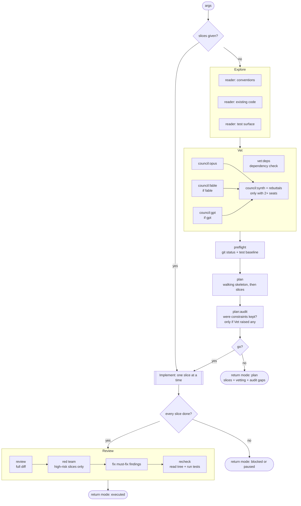
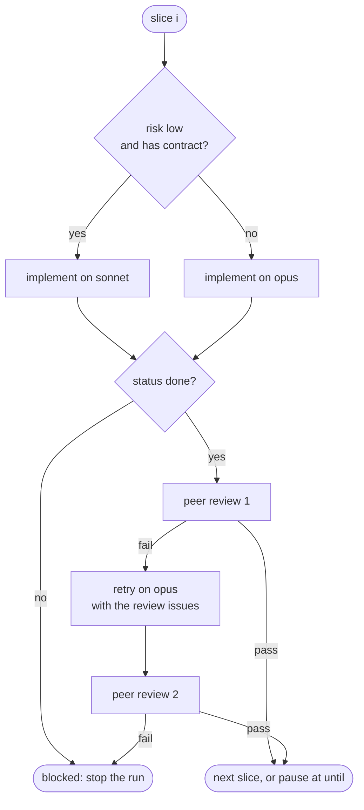
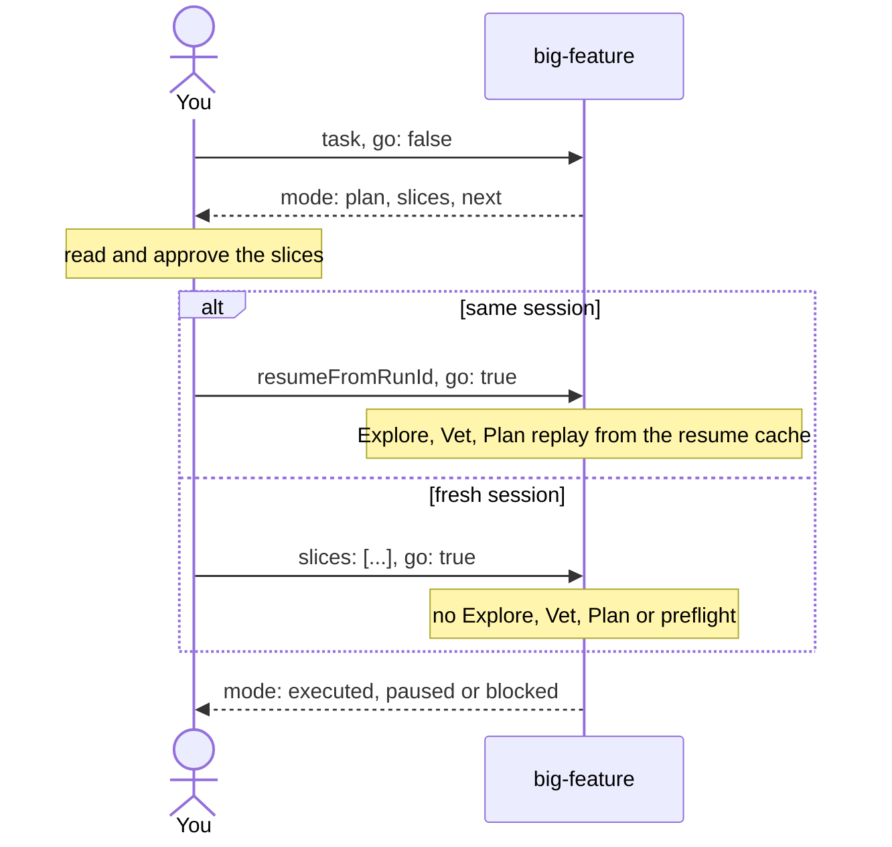

# big-feature

How `big-feature.js` runs, as of the current script. Read the script for exact
prompts and schemas; this file shows the shape.

## Arguments

| Arg | Default | Effect |
| --- | --- | --- |
| `task` | required | What to build. A plain string works as `args`. |
| `dir` | current working directory | Repo the agents work in. Pass an absolute path. |
| `go` | `false` | `false` stops after the plan. `true` implements. |
| `until` | all slices | Stop after this many slices, to read the diff between runs. |
| `slices` | none | An approved plan from an earlier run. Skips Explore, Vet and Plan. |
| `gpt` | `false` | Adds a GPT council seat through `codex exec` (`true`/`sol`, or `astra`). |
| `fable` | `false` | Adds a Fable council seat and plans on Fable instead of Opus. |

## Overview

Explore, Vet and the council seats run in parallel. Everything from Plan on
runs in sequence.

## One slice

"done" is the implementer's own report. Neither the peer review nor the loop
re-runs the slice's verification command.

## Plan, then execute

## Known issues

From the audit of 2026-11-02. Each one needs a failing test before its fix.

- The codex heredoc terminator is indented, so the `PROMPT` heredoc never closes.
- Without `dir`, `codex exec -C` receives the text "the current working directory".
- When the council synthesis runs, `vet:deps` blocking findings never reach the planner.
- A carried plan (`slices` + `go`) skips preflight and restarts at slice 1, so it re-implements slices already in the tree.
- Same-session resume depends on the resume cache. Before Claude Code 2.1.305, `parallel()` fan-outs can rerun on resume, so the planner can run again and execute a plan you did not approve.
- The slice's `exitCode` is part of the result schema, but no step reads it.
- With `go: true`, plan-audit gaps only reach the log; execution continues.
