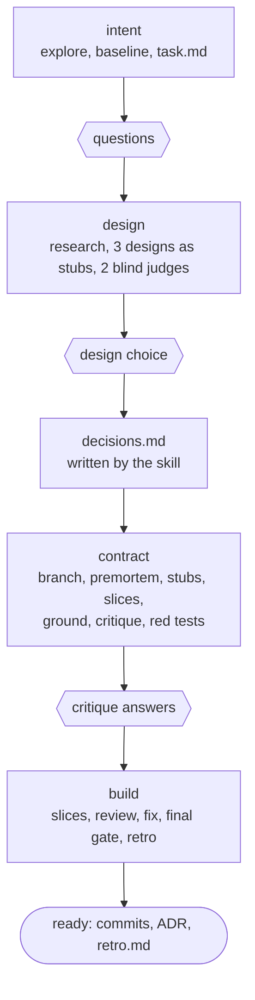
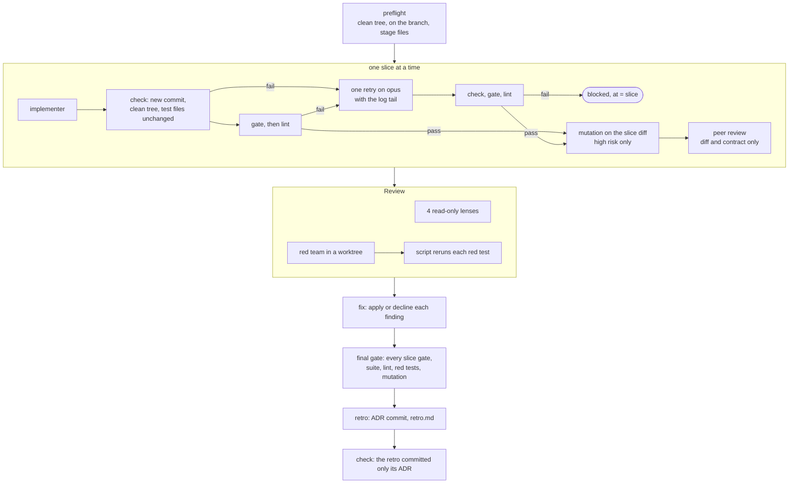

# feature

How `feature.js` runs, as of the current script. Read the script for exact
prompts and schemas; this file shows the shape. The `/feature` skill drives it
and relays the questions between stages.

## Arguments

Each run is one stage. State lives in `<dir>/.claude/runs/<slug>/`, which git
does not track.

| Arg | Default | Effect |
| --- | --- | --- |
| `stage` | required | `intent`, `design`, `contract` or `build`. |
| `dir` | required | Absolute path of the repo. |
| `slug` | required | Kebab-case name of the run. One task, one slug. |
| `today` | required | `YYYY-MM-DD`. The script has no clock; research dates its reads with it. |
| `task` | required by `intent` | What to build. |
| `gpt` | `"astra"` | `contract` only: the critique call. `"sol"` is cheaper, `false` skips it. |
| `from` | `0` | `build` only: the slice index to resume at. A `from` equal to the slice count skips every slice and starts at the review. |

## Overview



Every stage can end `needs-human` instead. `contract` and `build` can also end
`blocked`. `build` can also end `invalidated`, when an experiment slice
measures against its hypothesis.

## Build



The script keeps a review finding only with `path:line` evidence. It keeps a
red-team finding only when it sees the test fail. A finding the fix neither
applies nor declines blocks the run.

## Resume

`build.json` records each built slice with its head, and the findings of each
slice. A rerun with `from: n` starts where slice `n - 1` ended, and carries
those slices and findings. An early block, before the first slice, does not
write `build.json`, so a failed rerun keeps the record.

## Measure

`tests/feature-eval/metrics.py` reads the workflow journals of both workflows:

```sh
python3 tests/feature-eval/metrics.py            # markdown tables
python3 tests/feature-eval/metrics.py --json
python3 tests/feature-eval/metrics.py --merged main
```

Per feature run, it reports the status of each stage, `groundFalse`, the ledger
verdicts, the build findings by source and outcome, the mutation results, and
the cost. `--merged REF` counts the lines changed after a ready build, from the
branch tip at the end of the run to `REF`, on the files the run changed. Later
unrelated edits to those files count too, so read it as an upper bound. The
tip is the last branch commit before the run ended. A rebase gives every commit
a later date, and a deleted branch has no tip, so measure before either.

The stop rates count finished runs only: a feature stage with a result, and a
big-feature run in `executed`, `blocked` or `paused` mode.

## Known limits

- Gate budgets are clamped to 570 s: one Bash call has a 600 s cap.
- The build does not enforce one commit per slice. A resume after a user fix
  adds commits, so the script reviews and mutates the range `start..head`.
- The final gate runs the suite once. A flaky test blocks the build, and a
  resume replays the cached failure: only a changed command text runs it again.
- The `sh()` runner relays output through an agent. Above about 30 KB, the
  relay can drop or alter text without an error, so keep stage inputs small.
- The auto-mode safety check can refuse a `bash -c` script by mistake. The
  step then fails, and only a changed command text gets past the cache.
- `build.json` grows with each resume, because it carries the earlier findings.
- A slice gate that filters tests by name passes with zero tests run when a
  `mod` line is removed: the script does not protect `mod` lines.
